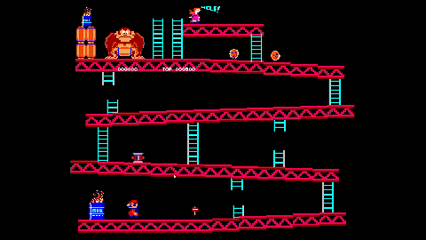

# Donkey Kong Remake (GCL2 CA3)

**Unity · C# · Year 2 Sem 1, Singapore Polytechnic**
**Team of 4:** Rae Ean, Xin Hui, Cleo and me (Kia Lent)
**My role:** gameplay audio and core game logic

▶ **Full gameplay video (with sound):** [klntxo.github.io/portfolio](https://klntxo.github.io/portfolio/#portfolio)

## The brief
Recreate Donkey Kong in Unity as a team of four, with each member adding one new feature of their own. **My feature was the adaptive gameplay audio.**

## Scripts I wrote

| Script | What it does |
|---|---|
| `AdaptiveAudioManager.cs` | **My new feature.** Crossfades from a calm track to an intense one based on how high Mario has climbed |
| `LevelManager.cs` | 3-second countdown before play starts, restarts the level on death, loads the win screen |
| `Ladder.cs` | Climbing with gravity off, climb animation that pauses when Mario stops, dropping down through platforms |
| `Princess.cs` | Win condition when Mario reaches the Princess |

I also built the barrel spawning and movement.

## Problems I solved
- **Swapping music tracks made the song restart.** Both tracks start together and loop the whole time, and only their volumes change, so they always stay in sync.
- **Reaching the Princess didn't always trigger the win.** I added a backup distance check, plus a flag so the win screen only loads once.
- **Mario couldn't climb down past the platform he was standing on.** While Down is held on a ladder, Mario's collider stops blocking, and it goes back to normal when he leaves the ladder.

## What I'd improve
- Smooth the crossfade over time (or use an Audio Mixer) so the music doesn't jump when Mario falls.
- Read the top and bottom heights from the level instead of typing them in.
- Fix the root cause of the missed win trigger, and store the player reference once instead of searching every frame.
- Show the countdown on screen and play a death animation before restarting.

## Controls
- **Up / Down (W / S or arrow keys):** climb ladders
