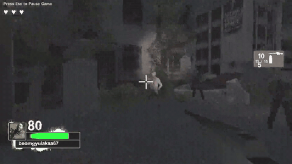

# Left 4 Dead Remake (GCL2 CA4)

**Unity · C# · Year 2 Sem 1, Singapore Polytechnic**
**Team of 4:** Rae Ean, Xin Hui, Cleo and me (Kia Lent)
**My role:** enemy AI, the shove, enemy animations, camera shake and all game audio

▶ **Full gameplay video:** [klntxo.github.io/portfolio](https://klntxo.github.io/portfolio/#portfolio)

## The brief
Recreate Left 4 Dead in Unity as a team of four.

## Scripts I wrote

| Script | What it does |
|---|---|
| `EnemyBase.cs` | Parent class for every zombie: idle, chase, attack and death states, health, hit flinches, 3D spatial sound |
| `BasicEnemy.cs` | Swarm zombie with its own stats and random idle groans |
| `WitchEnemy.cs` | Cries louder and higher-pitched as you get closer, screams when startled, then chases at 1.1× your speed |
| `PlayerShove.cs` | Right-click shove with a cooldown that knocks zombies back and interrupts their attacks |
| `PlayerHealth.cs` | Death audio sequence: fades all zombie sounds out under the player's scream, then back in |
| `MusicManager.cs` | Menu music and gameplay ambience that fade between scenes |
| `UISoundManager.cs`, `UIButtonSounds.cs` | Hover and click sounds for the menus |
| `CameraShake.cs` | Screen shake when a grenade explodes |

## Problems I solved
- **Shoved zombies slid through walls.** I moved them with their NavMesh agent during the knockback instead of with physics, so they always stay on walkable ground.
- **The death scream got drowned out by zombie groans.** All enemy audio pauses, fades out over 0.4 s, the scream plays, then everything fades back in at its original volume.
- **The shove missed zombies right in front of you.** A wide sphere cast replaced a thin line check, so anything close in front of the camera gets hit.

## What I'd improve
- Use Unity's Audio Mixer (snapshots and ducking) instead of a global on/off switch for enemy audio.
- Object pooling for zombies so bigger hordes run smoothly.
- A line-of-sight check, and a proper flinch animation instead of reusing the start of the death animation.

## Controls
- **Right-click:** shove
