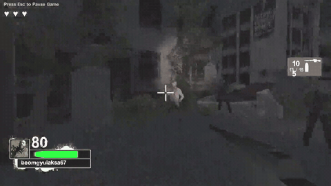
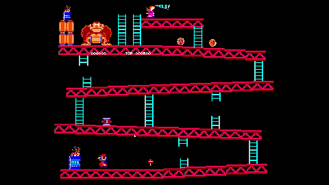

# Unity Game Projects

Unity C# projects by **Kia Lent Sng**, a Year 2 Animation & Games student at Singapore Polytechnic.
Portfolio: [klntxo.github.io/portfolio](https://klntxo.github.io/portfolio/)

| Project | What I did | |
|---|---|---|
|  | **[Left 4 Dead Remake](GCL2-CA4-L4D)** Team of 4 · Enemy AI (zombies and the Witch), shove, enemy animations, camera shake, 3D spatial audio | Unity · C# |
|  | **[Donkey Kong Remake](GCL2-CA3-DonkeyKong)** Team of 4 · Adaptive music (my new feature), level manager, barrels, ladders, win condition | Unity · C# |

Open a project folder to see the scripts I wrote, the problems I solved and what I'd improve.
